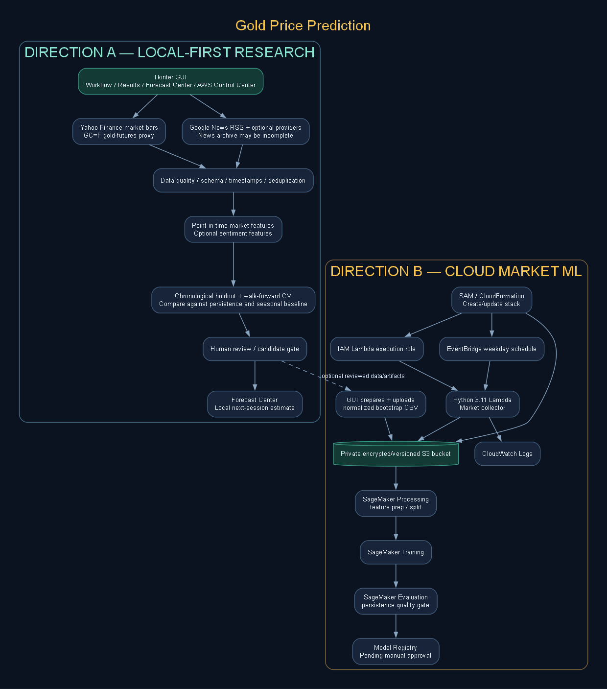

# Gold Price Prediction Workbench

A desktop research application for collecting gold-market data and financial news, engineering time-aware features, evaluating machine-learning models, and exploring an optional AWS-based workflow. The project combines a Tkinter interface with reproducible Python pipelines, model-governance checks, diagnostics, and cloud deployment utilities.

> **Research disclaimer:** This project is intended for education and quantitative research. It is not investment advice and does not establish a profitable trading strategy. Model outputs should not be used as the sole basis for financial decisions.

## Contents

- [Overview](#overview)
- [Capabilities](#capabilities)
- [Architecture](#architecture)
- [Requirements](#requirements)
- [Installation](#installation)
- [Launch the application](#launch-the-application)
- [Recommended workflow](#recommended-workflow)
- [Execution modes](#execution-modes)
- [Command-line workflows](#command-line-workflows)
- [Configuration and credentials](#configuration-and-credentials)
- [Testing](#testing)
- [Data and model limitations](#data-and-model-limitations)
- [Repository map](#repository-map)
- [Documentation](#documentation)

## Overview

The application supports two complementary execution modes:

1. **Local-first research:** collect and inspect data, engineer features, train and evaluate models on a Windows workstation, and optionally store selected data or artifacts in AWS.
2. **Cloud-based market ML:** use AWS storage and scheduled collection, then run configured data preparation, model training, evaluation, and model-registration steps with Amazon SageMaker.

The local-first workflow is the recommended starting point. It is easier to debug and makes it possible to assess data quality and model performance before incurring cloud-compute costs.

## Capabilities

### Desktop application

- Tkinter/ttk graphical interface with a workflow-oriented research experience.
- Forecast Center for generating a next-session research estimate from an approved local model.
- AWS Control Center for identity checks, SAM validation/build, resource inspection, data upload, and SageMaker pipeline initiation.
- Live command output and status messages to help diagnose failures.

### Market and news data

- Gold futures proxy and configurable related-market symbols, collected through `yfinance`.
- News ingestion through public Google News RSS and optional API-based providers, subject to provider availability and credentials.
- News ingestion logs, archive auditing, timestamp normalization, and time-alignment checks.
- Optional FinBERT sentiment scoring and a live headline/sentiment monitor.
- News features can be evaluated alongside market-only features; market-only remains a useful baseline.

### Machine learning and evaluation

- Market-feature engineering using historical price and related-market data.
- Candidate models including XGBoost, Random Forest, Extra Trees, and HistGradientBoosting.
- Chronological holdout evaluation and walk-forward validation to reduce time-series leakage.
- Optional hyperparameter tuning and feature selection within the training workflow.
- Baseline comparisons, feature manifests, evaluation reports, and explicit candidate-approval controls.
- Forecast generation from an approved champion model, with output written to `artifacts/latest_forecast.json`.

### AWS workflow

- AWS SAM template for an encrypted, private S3 bucket, a Lambda market collector, its execution role, and an EventBridge schedule.
- Scripts for uploading historical data, starting SageMaker pipeline executions, registering models, and optional model deployment/invocation tasks.
- Documentation distinguishes resources defined by the SAM template from additional SageMaker resources that must be configured and executed separately.

## Architecture


For detailed diagrams, see the . 

## Requirements

- Windows 10/11 or another supported desktop environment with Python installed.
- Python 3.11 recommended for the documented Windows setup.
- VS Code or another terminal/editor.
- Internet access for market/news ingestion and package installation.
- AWS CLI and AWS SAM CLI only if using the AWS workflow.
- AWS credentials and appropriate IAM permissions only for cloud operations.

Optional components:

- FinBERT sentiment analysis requires the additional packages in `requirements-nlp.txt` and may download model weights on first use.
- SageMaker workflow execution requires the packages in `sagemaker/requirements.txt`, an accessible S3 input location, and a correctly configured SageMaker execution role.

## Installation

Open a PowerShell terminal in the repository root.

```powershell
py -3.11 -m venv .venv
.\.venv\Scripts\python.exe -m pip install --upgrade pip
.\.venv\Scripts\python.exe -m pip install -r requirements.txt
```

The commands above create a project-local Python environment and install the main dependencies. If `py -3.11` is not available, install Python 3.11 and ensure the Python launcher can find it.

### Optional dependencies

Install the NLP dependencies for FinBERT sentiment scoring:

```powershell
.\.venv\Scripts\python.exe -m pip install -r requirements-nlp.txt
```

Install the SageMaker SDK dependencies when using the cloud ML workflow:

```powershell
.\.venv\Scripts\python.exe -m pip install -r sagemaker/requirements.txt
```

AWS CLI and SAM CLI are separate tools; install and configure them using their official documentation before using AWS Control Center.

## Launch the application

From the repository root:

```powershell
.\.venv\Scripts\python.exe gui\app.py
```

The main research and forecast workflows run directly from the desktop application. The optional FastAPI service in `src/serving/` is a separate interface and is not required to open the GUI or use the Forecast Center.

## Recommended workflow

1. **Inspect configuration.** Review the symbol, news-provider, lookback-window, and model settings.
2. **Collect market data.** Use the GUI workflow or the relevant command-line script.
3. **Collect news.** Select an available provider, configure optional credentials if required, and inspect provider status in the console.
4. **Audit the data.** Review `data/raw/news.csv`, `data/raw/news_ingestion_log.csv`, and the generated data-quality reports. A successful command is not proof that a provider returned useful data.
5. **Optionally score news.** Install the NLP dependencies and run sentiment scoring when needed.
6. **Prepare features.** Run feature preparation and confirm that market and news timestamps are aligned without using future information.
7. **Train and evaluate.** Use chronological holdout data and walk-forward validation. Compare each candidate with simple baselines.
8. **Review before approval.** Inspect metrics, warnings, and data coverage before promoting a candidate. Human approval is a governance step, not proof that a model is predictive.
9. **Generate a forecast.** Open Forecast Center after an approved champion model and its manifest are available.
10. **Use AWS optionally.** First verify the AWS identity and region, then validate/build the SAM template, deploy only after reviewing the proposed resources, and verify execution in CloudFormation, S3, Lambda, and CloudWatch. Configure SageMaker separately before starting its pipeline.

## Execution modes

### Local-first research

Data ingestion, feature engineering, model selection, and evaluation run on the local computer. Selected data or artifacts can be uploaded to S3. This mode is suitable for development, diagnostics, and repeatable experiments without requiring cloud compute for each run.

### Cloud-based market ML

The SAM template provisions the foundational market-data collection resources. The separate SageMaker workflow supports cloud-side preprocessing, training, evaluation, and model registration when its inputs, role, and AWS configuration are supplied.

**Scope boundary:** The current cloud pipeline is market-data focused. End-to-end historical news collection, point-in-time news archives, cloud sentiment scoring, and a continuously hosted prediction endpoint are not automatically provisioned by the SAM template. Review `docs/AWS_project_RUNBOOK.md` and the AWS beginner roadmap before deployment.

## Command-line workflows

Run commands from the repository root using the project's Python environment.

### Fetch public news headlines

```powershell
.\.venv\Scripts\python.exe scripts\fetch_news.py --source google_news_rss --query "gold OR bullion OR Federal Reserve OR inflation" --count 100
```

Provider availability and the historical coverage returned depend on the source. Recent headlines do not create a valid historical news archive for earlier market dates.

### Audit the news archive

```powershell
.\.venv\Scripts\python.exe scripts\audit_news_archive.py
```

### Generate a next-session forecast

```powershell
.\.venv\Scripts\python.exe scripts\predict_next_session.py --period 2y
```

This requires a compatible approved model and champion manifest. The forecast refers to the next available trading session, which may not be the next calendar day. The command writes `artifacts/latest_forecast.json` when successful.

### Train and evaluate locally

```powershell
.\.venv\Scripts\python.exe scripts\train_local.py --test-fraction 0.20
```

Use the GUI for the complete workflow when you prefer guided controls and visible run output. Review the script's `--help` output for any additional supported options.

### Validate and build the AWS SAM template

```powershell
sam validate --lint --template-file template.yaml
sam build --template-file template.yaml
```

A successful build prepares deployment artifacts locally; it does not create AWS resources. Deployment is a separate, billable action.

### Run the test suite

'''powershell
$env:PYTHONPATH = "."
.\.venv\Scripts\python.exe -m pytest -q
'''

## Configuration and credentials

- Copy `.env.example` to `.env` only when local environment settings or optional API credentials are needed.
- Never commit `.env`, API keys, access keys, tokens, or private data.
- `.env.example` is a template only; it should not contain real secrets.
- For AWS, prefer an AWS CLI named profile or AWS IAM Identity Center/SSO over long-lived access keys.
- Check `aws sts get-caller-identity` and the selected region before deploying resources.
- Follow least-privilege IAM practices. Do not grant broad permissions merely to make a failing command succeed.
- Review estimated and actual AWS charges. Stop or delete resources when they are no longer needed.

## Testing

The `tests/` directory covers feature engineering, news ingestion, time alignment, API request handling, and SageMaker data preparation. Run the tests after changing ingestion, feature generation, evaluation, or serving logic.

The project also includes GitHub Actions CI configuration under `.github/workflows/`.

## Data and model limitations

- The default `GC=F` symbol is a Yahoo Finance continuous gold-futures proxy. It is not an official spot-gold quote or a guaranteed official settlement feed.
- Public news providers can rate-limit requests, change formats, omit older stories, or return no usable rows. Check ingestion logs and data-quality reports.
- News features are only valid for a backtest when the article timestamps and feature-availability times are aligned correctly with each market observation.
- Sentiment scores are signals to evaluate, not proof of economic relevance or predictive power.
- Chronological validation and baseline comparisons are essential. A model should not be described as successful unless its performance supports that claim on appropriate held-out data.
- The live news monitor is a headline/sentiment monitor, not a validated intraday gold-price forecasting system.
- Cloud deployment, SageMaker execution, and endpoint hosting require separate configuration and may incur charges.

## Repository map

See [`Project Structure.md`](Project%20Structure.md) for a directory-by-directory guide.

## Documentation

- [`Project Structure.md`](Project%20Structure.md) — repository layout
- [`docs/ARCHITECTURE.md`](docs/ARCHITECTURE.md) — architecture notes
- [`architectures/`](architectures/) — architecture diagrams and editable Graphviz sources

---

Built for transparent experimentation, reproducible evaluation, and careful separation between research results and production claims.
